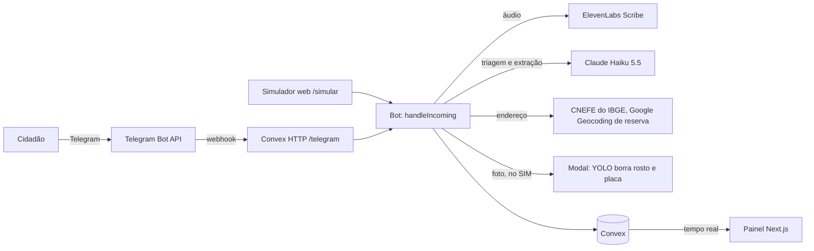

# Fiscaliz.ai

**Do aviso do cidadão ao órgão certo da prefeitura, sem triagem manual.**

O Fiscaliz.ai automatiza a triagem e o roteamento de demandas urbanas de Apucarana, PR. O cidadão manda pelo Telegram, em texto, áudio ou localização, que tem um buraco na rua, um poste apagado ou entulho na calçada. Uma camada de IA entende a mensagem, pergunta só o que falta, classifica o problema, descobre o órgão responsável e põe a ocorrência num mapa público em tempo real. Vários cidadãos relatando o mesmo problema viram uma única ocorrência, que ganha **apelo**: quantas pessoas pedem aquela solução.

- **Para quem:** a Prefeitura de Apucarana, que passa a ver onde estão os problemas, quantas pessoas cada um afeta e qual secretaria deve agir.
- **Trilha:** 07, Logística e automação, do [Hack Brasil 2026](./RULES.md). O fluxo automatizado é a triagem e o roteamento: em vez de o cidadão descobrir sozinho qual secretaria procurar, a mensagem sai do Telegram direto para a fila do órgão responsável.

## Demo

- **Telegram:** [@FiscalizaiBot](https://t.me/FiscalizaiBot), o bot real. Mande texto, áudio ou localização.
- **Site:** https://fiscalizai-five.vercel.app, página que explica como usar.
- **Mapa:** https://fiscalizai-five.vercel.app/mapa
- **Simulador:** https://fiscalizai-five.vercel.app/simular, a mesma conversa no navegador, sem precisar de celular.
- **Vídeo da demo:** [em inglês, 2:28](https://d2ol7oe51mr4n9.cloudfront.net/user_3IH6s2x6op5CIWGya8iR1hp8f6B/9fd12a51-4a51-409d-9a2b-4cf0c2ec5e6a.mp4) (versão da submissão) · [em português, 2:41](https://d2ol7oe51mr4n9.cloudfront.net/user_3IH6s2x6op5CIWGya8iR1hp8f6B/9945b228-86ed-4f57-ac52-6803ae44c46c.mp4). Roteiro em [docs/marca/roteiro-demo.md](./docs/marca/roteiro-demo.md).

### Testar

1. Abra o bot acima e toque em **Começar** (ou abra `/simular`).
2. Escreva ou grave o problema, por exemplo: _"tem um buraco enorme na rua, quase caí de bicicleta"_.
3. Envie a localização pelo clipe 📎 → **Localização** do Telegram (no simulador, clique no mapa e toque em **Enviar localização**). Também dá para escrever o endereço: _"Avenida Curitiba, 500"_.
4. Confira o resumo e toque em **SIM**.
5. A resposta traz o link da ocorrência e o órgão responsável. Volte ao mapa (`/mapa`): a ocorrência aparece sem recarregar a página.

O local precisa estar em Apucarana, PR, e cada conta do Telegram pode confirmar até 5 relatos por dia.

Vale testar também:

- **Emergência:** _"caiu uma árvore em cima dos fios"_ → o bot indica o 193 e não registra nada.
- **Concessionária:** _"está vazando água no meio da rua"_ → o bot indica a Sanepar.
- **Apelo:** de outra conta do Telegram, ou de outra aba anônima do simulador (outro "cidadão"), relate o mesmo problema no mesmo lugar → _"agora são 2 pessoas"_.
- **Filtros:** no painel, filtre por categoria ou órgão; o link da página guarda o filtro.

## Marca e site

A landing page (`/`) explica como relatar pelo Telegram, como ler o mapa e o que o Fiscaliz.ai faz pela Prefeitura, com um vídeo de 1 minuto. Marca, cores e voz em [docs/marca/](./docs/marca/); componentes e tokens em [docs/design-system.md](./docs/design-system.md).

## Como funciona



1. **Triagem primeiro:** emergência vai para 190/192/193/199; água, esgoto e rede elétrica vão para Sanepar ou Copel. Nenhum dos dois vira relato: só um contador anônimo ([ADR 0001](./docs/adr/0001-emergencias-e-fora-de-escopo-so-contador-anonimo.md)).
2. **Coleta:** o bot pergunta só o que falta (problema, local), mostra um resumo e pede **SIM/NÃO**.
3. **Roteamento:** a categoria vem de uma lista fechada e define o órgão responsável, conforme o [COMPETENCIAS.md](./COMPETENCIAS.md).
4. **De-duplicação:** ocorrências abertas da mesma categoria num raio de 50 m (150 m sem número da rua) são candidatas; a IA confirma se é o mesmo problema. Se for, o apelo sobe.
5. **Foto:** o cidadão pode mandar 1 foto. No SIM ela passa por um worker no Modal que borra rostos e placas; só a cópia borrada vai para a página da ocorrência, e a original é apagada ([ADR 0010](./docs/adr/0010-fotos-anonimizadas.md)).
6. **Painel:** mapa e lista por apelo, filtros por categoria e órgão, página de cada ocorrência e fila por órgão.

A IA só preenche dados; quem decide o fluxo é uma máquina de estados em código, testada caso a caso ([ADR 0004](./docs/adr/0004-por-que-nao-langgraph.md)). Detalhes em [docs/arquitetura.md](./docs/arquitetura.md) e nas [ADRs](./docs/adr/).

## Stack

Next.js (App Router) e Tailwind na Vercel · Convex (banco, funções, webhook, cron, tempo real) · MapLibre com tiles OpenFreeMap · Claude Haiku 5.5 · ElevenLabs Scribe · Modal com YOLO (fotos) · CNEFE do IBGE e Google Geocoding · Telegram Bot API ([ADR 0009](./docs/adr/0009-telegram-no-lugar-do-whatsapp.md)) · Vitest e `convex-test`.

## Rodar localmente

Pré-requisitos: Node.js 22 e uma conta gratuita no [Convex](https://convex.dev).

```bash
npm install
npx convex dev            # cria o deployment de dev e preenche o .env.local
npx convex run seed:run   # carrega órgãos e ocorrências sintéticas
npm run dev               # http://localhost:3000
```

Variáveis do backend ficam no Convex, nunca no repositório:

```bash
npx convex env set ANTHROPIC_API_KEY ...
npx convex env set CITIZEN_HASH_SECRET "$(openssl rand -hex 32)"
npx convex env set GOOGLE_MAPS_API_KEY ...      # endereço em texto
npx convex env set PUBLIC_APP_URL http://localhost:3000
# Só para o Telegram (um bot por ambiente, criado no @BotFather):
npx convex env set TELEGRAM_BOT_TOKEN ...
npx convex env set TELEGRAM_WEBHOOK_SECRET "$(openssl rand -hex 32)"
npx convex env set ELEVENLABS_API_KEY ...       # áudio
# Só para fotos (worker em workers/blur/, ADR 0010):
npx convex env set MODAL_BLUR_URL https://<workspace>-<env>--fiscaliza-blur-blurworker-process.modal.run
npx convex env set MODAL_BLUR_SECRET ...        # o mesmo do modal.Secret
```

Sem `MODAL_BLUR_*`, a foto é recusada no SIM: o relato é registrado sem imagem e o bot avisa. Deploy do worker em [workers/blur/README.md](./workers/blur/README.md).

O mapa e o simulador funcionam só com `ANTHROPIC_API_KEY` e `CITIZEN_HASH_SECRET`; sem a chave do Google, use o pin no mapa em vez do endereço em texto. A lista completa está em [docs/arquitetura.md](./docs/arquitetura.md#variáveis-de-ambiente).

Para o Telegram, registre o webhook do bot com o mesmo segredo:

```bash
curl https://api.telegram.org/bot$TELEGRAM_BOT_TOKEN/setWebhook \
  -d url=https://<deployment>.convex.site/telegram \
  -d secret_token=$TELEGRAM_WEBHOOK_SECRET \
  -d 'allowed_updates=["message","callback_query"]'
```

O canal começou no WhatsApp, até a Meta banir a conta. O código continua em `convex/whatsapp/`, sem rota; a última versão que rodava está na release [`whatsapp-final`](https://github.com/jonathangaldino/fiscaliz.ai/releases/tag/whatsapp-final) ([ADR 0009](./docs/adr/0009-telegram-no-lugar-do-whatsapp.md)).

### Scripts

| Comando | O que faz |
|---|---|
| `npm run dev` | Painel e simulador |
| `npm test` | Testes unitários e de integração (sem chamar APIs externas) |
| `npm run typecheck` / `npm run lint` | Tipos e lint, como no CI |
| `npm run codegen` | Regenera `convex/_generated` sem precisar de deployment |
| `npm run eval` | Eval da triagem contra o Claude de verdade (custa; fora do CI). Resultado em [docs/eval-triagem.md](./docs/eval-triagem.md) |
| `npm run bench:streets` | Benchmark do match de nomes de rua com erro de digitação ([ADR 0007](./docs/adr/0007-damerau-levenshtein-no-nome-da-rua.md)) |
| `node scripts/cnefe.mjs download\|build ["Cidade, UF"]` | Baixa o CNEFE do IBGE e gera o módulo de ruas usado no geocoding ([docs/dados-ibge.md](./docs/dados-ibge.md)) |

## API aberta

As ocorrências saem do Fiscaliz.ai para onde a prefeitura já trabalha: GIS, mapas e planilhas. Só os campos públicos do painel; nenhum dado pessoal.

| Rota | Formato |
|---|---|
| `GET /api/ocorrencias.geojson` | GeoJSON (`FeatureCollection` de pontos), para QGIS, ArcGIS e mapas web |
| `GET /api/ocorrencias.csv` | CSV, para Excel e Google Sheets |

Filtros opcionais, com os mesmos nomes do painel:

- `orgao`: slug do órgão (`servicos-publicos`, `idepplan`, ...; ver [COMPETENCIAS.md](./COMPETENCIAS.md))
- `categoria`: chave da categoria (`pavement`, `street_lighting`, ...)
- `status`: `open`, `verifying` ou `resolved`

```bash
# Buracos abertos, para abrir no QGIS
curl "https://<site>/api/ocorrencias.geojson?categoria=pavement&status=open" -o buracos.geojson

# Tudo de Serviços Públicos, em planilha
curl "https://<site>/api/ocorrencias.csv?orgao=servicos-publicos" -o servicos-publicos.csv
```

Campos: `id`, `category`, `categoryLabel`, `agency`, `status`, `address`, `summary`, `appeal`, `lat`, `lng`, `openedAt`, `resolvedAt` (ISO 8601) e `url` da ocorrência. Ordem por apelo, no máximo 1000 itens; resposta em cache por 1 minuto. Valor de filtro inválido responde 400. A fila de cada órgão tem o link **Baixar dados** com o CSV já filtrado.

## Privacidade

- **Dados sintéticos:** o seed e a demo usam só ocorrências inventadas em ruas reais de Apucarana. Nenhum dado pessoal real (regra 9 do regulamento).
- **O cidadão nunca aparece no mapa.** Telefone, texto original, áudio e descrição do relato não chegam ao navegador: toda query pública declara o formato de retorno, e um teste confere que nenhum desses campos vaza.
- **Foto só borrada:** rostos e placas são borrados antes de publicar, a original é apagada logo depois e o arquivo é recodificado sem EXIF (sem GPS do celular). Se a borragem falha, a foto não é publicada.
- **Áudio não é guardado**; o telefone é identificado por HMAC com segredo, e só fica guardado para a verificação da V2.
- **Contato dos órgãos é só institucional:** nome do órgão, telefone, e-mail e site oficial. Nenhum nome de pessoa.

## Licença

[MIT](./LICENSE)
