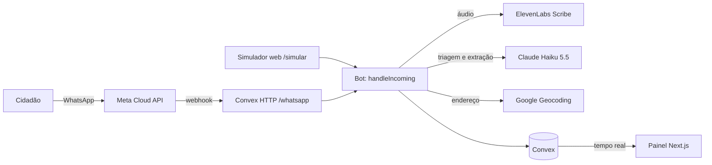

# Fiscaliza.i

**Do aviso do cidadão ao órgão certo da prefeitura, sem triagem manual.**

O Fiscaliza.i automatiza a triagem e o roteamento de demandas urbanas de Apucarana, PR. O cidadão manda pelo WhatsApp, em texto, áudio ou localização, que tem um buraco na rua, um poste apagado ou entulho na calçada. Uma camada de IA entende a mensagem, pergunta só o que falta, classifica o problema, descobre o órgão responsável e põe a ocorrência num mapa público em tempo real. Vários cidadãos relatando o mesmo problema viram uma única ocorrência, que ganha **apelo**: quantas pessoas pedem aquela solução.

- **Para quem:** a Prefeitura de Apucarana, que passa a ver onde estão os problemas, quantas pessoas cada um afeta e qual secretaria deve agir.
- **Trilha:** 07, Logística e automação, do [Hack Brasil 2026](./RULES.md). O fluxo automatizado é a triagem e o roteamento: em vez de o cidadão descobrir sozinho qual secretaria procurar, a mensagem sai do WhatsApp direto para a fila do órgão responsável.

## Demo

- **Painel:** https://fiscalizai-five.vercel.app
- **Simulador do WhatsApp:** https://fiscalizai-five.vercel.app/simular

### Testar pelo simulador

O número de teste da Meta só conversa com 5 telefones cadastrados, então o simulador web reproduz a conversa do WhatsApp no navegador.

1. Abra `/simular`.
2. Escreva o problema, por exemplo: _"tem um buraco enorme na rua, quase caí de bicicleta"_.
3. Clique no mapa para marcar o local e toque em **Enviar localização**. Também dá para escrever o endereço: _"Avenida Curitiba, 500"_.
4. Confira o resumo e toque em **SIM**.
5. A resposta traz o link da ocorrência e o órgão responsável. Volte ao mapa (`/`): a ocorrência aparece sem recarregar a página.

Vale testar também:

- **Emergência:** _"caiu uma árvore em cima dos fios"_ → o bot indica o 193 e não registra nada.
- **Concessionária:** _"está vazando água no meio da rua"_ → o bot indica a Sanepar.
- **Apelo:** em outra aba anônima (outro "cidadão"), relate o mesmo problema no mesmo lugar → _"agora são 2 pessoas"_.
- **Filtros:** no painel, filtre por categoria ou órgão; o link da página guarda o filtro.

## Como funciona



1. **Triagem primeiro:** emergência vai para 190/192/193/199; água, esgoto e rede elétrica vão para Sanepar ou Copel. Nenhum dos dois vira relato: só um contador anônimo ([ADR 0001](./docs/adr/0001-emergencias-e-fora-de-escopo-so-contador-anonimo.md)).
2. **Coleta:** o bot pergunta só o que falta (problema, local), mostra um resumo e pede **SIM/NÃO**.
3. **Roteamento:** a categoria vem de uma lista fechada e define o órgão responsável, conforme o [COMPETENCIAS.md](./COMPETENCIAS.md).
4. **De-duplicação:** ocorrências abertas da mesma categoria num raio de 50 m (150 m sem número da rua) são candidatas; a IA confirma se é o mesmo problema. Se for, o apelo sobe.
5. **Painel:** mapa e lista por apelo, filtros por categoria e órgão, página de cada ocorrência e fila por órgão.

A IA só preenche dados; quem decide o fluxo é uma máquina de estados em código, testada caso a caso ([ADR 0004](./docs/adr/0004-por-que-nao-langgraph.md)). Detalhes em [docs/arquitetura.md](./docs/arquitetura.md) e nas [ADRs](./docs/adr/).

## Stack

Next.js (App Router) e Tailwind na Vercel · Convex (banco, funções, webhook, cron, tempo real) · MapLibre com tiles OpenFreeMap · Claude Haiku 5.5 · ElevenLabs Scribe · Google Geocoding · WhatsApp Cloud API oficial ([ADR 0002](./docs/adr/0002-whatsapp-cloud-api-oficial.md)) · Vitest e `convex-test`.

## Rodar localmente

Pré-requisitos: Node.js 22 e uma conta gratuita no [Convex](https://convex.dev).

```bash
npm install
npx convex dev            # cria o deployment de dev e preenche o .env.local
npx convex run seed:run   # carrega órgãos e ocorrências sintéticas
npm run dev               # http://localhost:3000
```

Variáveis do backend ficam no Convex, nunca no repositório:

```bash
npx convex env set ANTHROPIC_API_KEY ...
npx convex env set CITIZEN_HASH_SECRET "$(openssl rand -hex 32)"
npx convex env set GOOGLE_MAPS_API_KEY ...      # endereço em texto
npx convex env set PUBLIC_APP_URL http://localhost:3000
# Só para o WhatsApp:
npx convex env set WHATSAPP_TOKEN ...
npx convex env set WHATSAPP_PHONE_NUMBER_ID ...
npx convex env set WHATSAPP_APP_SECRET ...
npx convex env set WHATSAPP_VERIFY_TOKEN ...
npx convex env set ELEVENLABS_API_KEY ...       # áudio
```

O mapa e o simulador funcionam só com `ANTHROPIC_API_KEY` e `CITIZEN_HASH_SECRET`; sem a chave do Google, use o pin no mapa em vez do endereço em texto. A lista completa está em [docs/arquitetura.md](./docs/arquitetura.md#variáveis-de-ambiente).

Para o WhatsApp, cadastre `https://<deployment>.convex.site/whatsapp` como webhook no app da Meta, com o mesmo `WHATSAPP_VERIFY_TOKEN`.

### Scripts

| Comando | O que faz |
|---|---|
| `npm run dev` | Painel e simulador |
| `npm test` | Testes unitários e de integração (sem chamar APIs externas) |
| `npm run typecheck` / `npm run lint` | Tipos e lint, como no CI |
| `npm run codegen` | Regenera `convex/_generated` sem precisar de deployment |
| `npm run eval` | Eval da triagem contra o Claude de verdade (custa; fora do CI) |

## Privacidade

- **Dados sintéticos:** o seed e a demo usam só ocorrências inventadas em ruas reais de Apucarana. Nenhum dado pessoal real (regra 9 do regulamento).
- **O cidadão nunca aparece no mapa.** Telefone, texto original, áudio e descrição do relato não chegam ao navegador: toda query pública declara o formato de retorno, e um teste confere que nenhum desses campos vaza.
- **Áudio não é guardado**; o telefone é identificado por HMAC com segredo, e só fica guardado para a verificação da V2.
- **Contato dos órgãos é só institucional:** nome do órgão, telefone, e-mail e site oficial. Nenhum nome de pessoa.

## Licença

[MIT](./LICENSE)
