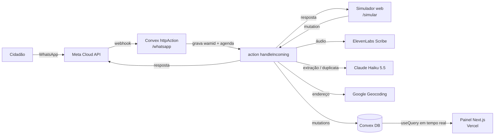
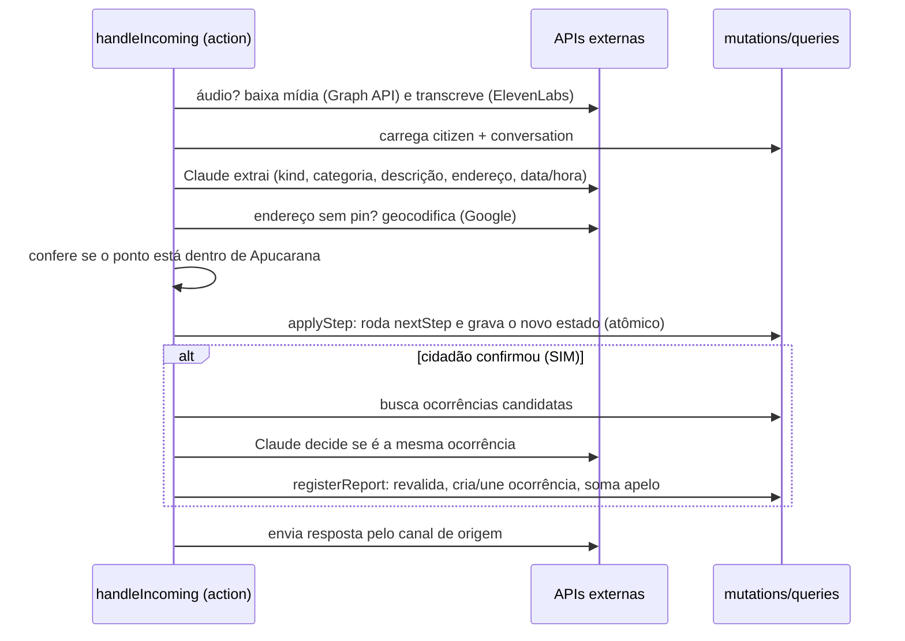
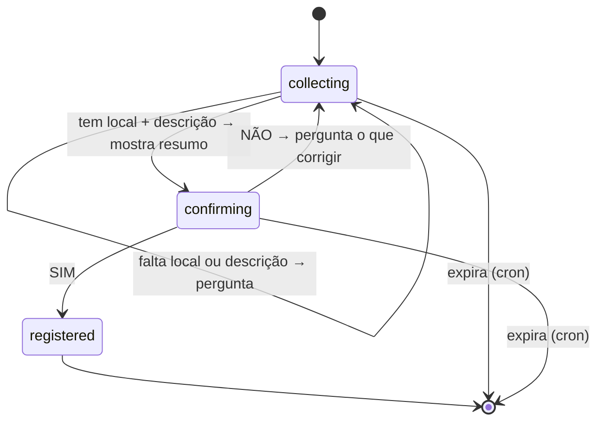

# Arquitetura do Fiscaliz.ai

Este documento detalha como a V1 é construída. As decisões e seus porquês estão nas ADRs ([0001](./adr/0001-emergencias-e-fora-de-escopo-so-contador-anonimo.md), [0002](./adr/0002-whatsapp-cloud-api-oficial.md), [0003](./adr/0003-arquitetura-v1.md), [0004](./adr/0004-por-que-nao-langgraph.md), [0005](./adr/0005-geocodificacao-pelo-cnefe-do-ibge.md), [0006](./adr/0006-cnefe-em-arquivo-no-servidor.md), [0007](./adr/0007-damerau-levenshtein-no-nome-da-rua.md)). O vocabulário segue o [GLOSSARY](../GLOSSARY.md); os nomes no código seguem a tabela "Nomes no código" de lá.

## Sumário

- [Visão geral](#visão-geral)
- [Stack](#stack)
- [Estrutura de pastas](#estrutura-de-pastas)
- [Modelo de dados](#modelo-de-dados)
- [Recebimento de mensagens](#recebimento-de-mensagens)
- [Processamento de uma mensagem](#processamento-de-uma-mensagem)
- [Máquina de estados da conversa](#máquina-de-estados-da-conversa)
- [Camada de IA](#camada-de-ia)
- [Localização](#localização)
- [De-duplicação e apelo](#de-duplicação-e-apelo)
- [Canais: WhatsApp e simulador](#canais-whatsapp-e-simulador)
- [Painel](#painel)
- [Privacidade](#privacidade)
- [Variáveis de ambiente](#variáveis-de-ambiente)
- [Testes e qualidade](#testes-e-qualidade)
- [Deploy](#deploy)
- [Preparação para a V2](#preparação-para-a-v2)
- [Riscos](#riscos)

## Visão geral



Um único app Next.js com a pasta `convex/` dentro. O Convex é o backend inteiro: banco, funções, webhook, agendamentos e tempo real. O Next.js só desenha o painel e o simulador.

## Stack

| Camada | Escolha | Por quê |
|---|---|---|
| Frontend | Next.js (App Router), TypeScript, Tailwind, shadcn/ui | Deploy simples na Vercel; componentes prontos e acessíveis |
| Backend | Convex | Banco transacional + funções + agendador + reatividade num lugar só |
| Mapa | MapLibre via `react-map-gl/maplibre`, tiles OpenFreeMap | Vetorial, grátis, sem chave; o OSM raster oficial proíbe uso pesado |
| IA | Claude Haiku 5.5 (SDK `@anthropic-ai/sdk`) | Rápido e barato para chat; qualidade medida pelo eval |
| Transcrição | ElevenLabs Scribe | Boa qualidade em pt-BR |
| Geocodificação | Google Geocoding API | Melhor precisão para rua + número em cidade pequena |
| Mensageria | WhatsApp Cloud API oficial | ADR 0002 |
| Testes | Vitest + `convex-test` | Testa funções Convex sem deploy |
| CI | GitHub Actions | Typecheck, lint e testes em todo PR |

## Estrutura de pastas

```
app/
  page.tsx                    # mapa + lista + filtros
  ocorrencias/[id]/page.tsx   # detalhe (link enviado ao cidadão)
  orgaos/[slug]/page.tsx      # fila e contadores do órgão
  simular/page.tsx            # chat que simula o WhatsApp
components/                   # mapa, lista, filtros, chat
convex/
  schema.ts
  http.ts                     # webhook do WhatsApp
  occurrences.ts              # queries públicas do painel
  agencies.ts
  simulator.ts                # mutations/queries do simulador
  crons.ts                    # expiração de conversas
  seed.ts                     # dados sintéticos de Apucarana
  bot/
    stateMachine.ts           # nextStep: função pura (ADR 0004)
    handleIncoming.ts         # action que orquestra o processamento
    extract.ts                # chamadas ao Claude
    dedup.ts
    transcribe.ts             # ElevenLabs
    geocode.ts                # Google
    channels/
      whatsapp.ts
      simulator.ts
  lib/
    categories.ts             # fonte única de categorias → órgão (de COMPETENCIAS.md)
    geo.ts                    # haversine, point-in-polygon
    apucarana.geo.json        # limite do município (IBGE 4101408)
evals/
  fixtures.jsonl              # mensagens de exemplo + resultado esperado
  run.ts
```

As rotas públicas (`/ocorrencias`, `/orgaos`, `/simular`) ficam em pt-BR porque o cidadão as vê no link. Fora isso, nomes de arquivo e de código são em inglês.

## Modelo de dados

Tabelas do Convex (`convex/schema.ts`):

| Tabela | Campos principais | Índices |
|---|---|---|
| `agencies` | `slug`, `name`, `phone`, `email`, `url` (só contato institucional) | `by_slug` |
| `occurrences` | `category`, `agencyId?` ("Outros" não tem órgão), `status` (`open` / `verifying` / `resolved`), `lat`, `lng`, `address`, `summary` (texto público reescrito pela IA), `appeal`, `openedAt`, `verificationStartedAt?`, `resolvedAt?`, `source` (`whatsapp` / `simulator` / `seed`) | `by_category_status`, `by_status_appeal`, `by_agency_status` |
| `reports` | `occurrenceId`, `citizenId`, `description` (interna, nunca vai ao navegador), `occurredAt`, `createdAt` | `by_occurrence_citizen`, `by_citizen_createdAt` |
| `citizens` | `channel`, `externalIdHash` (HMAC do telefone ou da sessão do simulador), `phone?` (só WhatsApp; a V2 precisa dele) | `by_channel_hash` |
| `conversations` | `citizenId`, `state` (união discriminada, ver abaixo), `updatedAt` | `by_citizen`, `by_updatedAt` |
| `processedMessages` | `channel`, `messageId` | `by_channel_message` |
| `anonymousCounters` | `kind` (`emergency` / `out_of_scope`), `target` (ex.: `samu`, `sanepar`), `createdAt` | `by_kind` |

- **`appeal` é desnormalizado**: a mesma mutation que insere o primeiro relato de um cidadão numa ocorrência incrementa o campo. Assim o mapa ordena por apelo sem contar relatos a cada leitura.
- **Um cidadão conta uma vez por ocorrência**: se ele relatar de novo a mesma ocorrência, o bot responde "você já relatou" e nada muda.
- **`anonymousCounters` não tem telefone, texto nem local** (ADR 0001).

## Recebimento de mensagens

`convex/http.ts` expõe duas rotas em `/whatsapp`:

- **`GET`**: verificação do webhook. Compara `hub.verify_token` com `WHATSAPP_VERIFY_TOKEN` e devolve `hub.challenge`.
- **`POST`**: mensagens recebidas.
  1. Valida `X-Hub-Signature-256` (HMAC-SHA256 do corpo cru com `WHATSAPP_APP_SECRET`, via `crypto.subtle`). Se a assinatura for inválida, responde 401.
  2. Para cada mensagem do payload, chama uma mutation que insere `(channel, messageId)` em `processedMessages`. Se já existir, ignora: a Meta reenvia mensagens quando não recebe 200 a tempo.
  3. Agenda `bot.handleIncoming` com `ctx.scheduler.runAfter(0, ...)`.
  4. Responde 200 na hora, sem esperar a IA.

Notificações de status (entregue, lido) são ignoradas.

## Processamento de uma mensagem

`handleIncoming` é uma action (pode chamar APIs externas). Ela orquestra e delega toda gravação a mutations.



- **Normalização**: texto, áudio transcrito e pin viram uma mesma entrada `{ text?, lat?, lng?, receivedAt }`.
- **Concorrência**: `applyStep` recebe a versão do estado que a action leu e recusa a gravação se ela mudou no meio. Mutations do Convex são serializáveis; isso cobre duas mensagens do mesmo cidadão chegando juntas.
- **Falha externa** (IA, transcrição ou geocodificação fora do ar): o bot pede para o cidadão tentar de novo e não grava nada.

## Máquina de estados da conversa

`nextStep(state, extraction): Step` em `convex/bot/stateMachine.ts` é uma função pura (ADR 0004). A IA preenche `extraction`; a função decide o que fazer.



Regras aplicadas antes de qualquer transição, em qualquer estado:

| Ordem | Condição | Passo |
|---|---|---|
| 1 | `extraction.kind = emergency` | Redireciona para 190/192/193/199, grava contador anônimo, encerra a conversa |
| 2 | `extraction.kind = out_of_scope` | Informa o canal da Sanepar ou da Copel, grava contador anônimo, encerra |
| 3 | `extraction.kind = invalid` | Recusa: não é problema urbano |
| 4 | Cidadão já tem 5 relatos confirmados hoje (fuso de Brasília) | Recusa por limite diário |
| 5 | Local fora de Apucarana | Pede outro local |

Outros detalhes:

- **Data/hora do relato**: a hora da mensagem, salvo se o cidadão informar outra.
- **Expiração**: `crons.ts` apaga, a cada 10 min, conversas sem atividade há 30 min. Conversa expirada não vira relato.
- **Confirmação**: no WhatsApp, botões interativos SIM/NÃO; no simulador, os mesmos botões renderizados no chat.

## Camada de IA

Duas funções em `convex/bot/extract.ts`, ambas com Claude Haiku 5.5 e saída estruturada (`output_config.format`) validada com Zod:

1. **`extract`**: recebe o rascunho atual da conversa e a nova mensagem. Devolve:
   - `kind`: `urban` / `emergency` / `out_of_scope` / `invalid`
   - `emergencyTarget` ou `outOfScopeTarget` quando for o caso
   - `category`: enum gerado de `categories.ts` (16 categorias + `other`)
   - `description`, `address`, `occurredAt` (só o que a mensagem trouxe)
   - `publicSummary`: texto curto, sem dados pessoais, para o painel
2. **`isSameOccurrence`**: recebe o relato novo e até 5 ocorrências candidatas. Devolve o `id` da ocorrência igual ou `null`.

Regras de prompt:

- Lista de categorias, exemplos de `COMPETENCIAS.md` e a regra das árvores ficam no system prompt, que é estável e vai primeiro (favorece o cache de prompt).
- O texto do cidadão vai como dado, nunca como instrução. O enum de saída limita o estrago de uma tentativa de prompt injection.
- O esforço de raciocínio (`effort`) começa em `low` e sobe só se o eval mostrar ganho.

## Localização

- **Pin**: usado direto. Uma geocodificação reversa (Google) gera o endereço exibido no painel.
- **Endereço em texto ou áudio**: primeiro o CNEFE do IBGE, depois o Google ([ADR 0005](./adr/0005-geocodificacao-pelo-cnefe-do-ibge.md), [ADR 0006](./adr/0006-cnefe-em-arquivo-no-servidor.md)).
  - **CNEFE**: as ruas e os números de Apucarana ficam em `convex/cnefe/4101408.ts`, gerado do CSV do IBGE em `data/cnefe/` (veja [dados-ibge.md](./dados-ibge.md)). Quando uma única rua contém todas as palavras do nome que o cidadão escreveu (sem match exato, com tolerância a erro de digitação pela distância de Damerau-Levenshtein, [ADR 0007](./adr/0007-damerau-levenshtein-no-nome-da-rua.md)), o ponto é o do número no IBGE ou fica entre os números vizinhos do mesmo lado da rua. É preciso quando o número existe, ou quando os vizinhos estão a até 200 m um do outro.
  - **Google Geocoding**, quando o CNEFE não acha a rua, com `components=locality:Apucarana|administrative_area:PR|country:BR`. `location_type` `ROOFTOP` ou `RANGE_INTERPOLATED` significa que o número foi encontrado: raio de de-duplicação de 50 m. `GEOMETRIC_CENTER` ou `APPROXIMATE` significa só a rua: raio de 150 m. Um `partial_match` só é aceito se tiver todas as palavras do nome, e nunca como preciso.
- **Limite do município**: o ponto precisa cair dentro do polígono de Apucarana (malha do IBGE, código 4101408, em `apucarana.geo.json`). Teste de point-in-polygon em `geo.ts`.

## De-duplicação e apelo

Ao confirmar um relato:

1. Busca ocorrências com `status = open` e mesma categoria (índice `by_category_status`).
2. Filtra em memória pela distância de haversine dentro do raio (50 m ou 150 m). O volume de uma cidade pequena não justifica índice geoespacial.
3. Se sobrar alguma, `isSameOccurrence` decide.
4. `registerReport` (mutation):
   - Confere que a ocorrência escolhida continua `open`.
   - Se o cidadão ainda não tem relato nela, cria o relato e soma 1 no `appeal`.
   - Sem candidata, cria uma ocorrência nova com `appeal = 1`.
5. Resposta ao cidadão:
   - Nova: "registrado" + link + órgão responsável.
   - Existente: "já relatado, seu apelo foi somado — agora são N pessoas" + link.

## Canais: WhatsApp e simulador

O núcleo do bot não sabe de onde veio a mensagem. Cada canal implementa:

```ts
interface Channel {
  send(citizen: Citizen, message: OutgoingMessage): Promise<void>; // texto ou botões
}
```

- **WhatsApp** (`channels/whatsapp.ts`): `POST` na Graph API com `WHATSAPP_TOKEN` e `WHATSAPP_PHONE_NUMBER_ID`. Mídia de áudio: busca a URL pelo `media_id` e baixa o binário com o mesmo token.
- **Simulador** (`channels/simulator.ts`): grava a resposta numa tabela que a página `/simular` assina com `useQuery`.
  - O cidadão do simulador é um id de sessão aleatório guardado no navegador.
  - Vale o mesmo limite de 5 relatos por dia.
  - Ocorrências criadas pelo simulador aparecem no mapa com `source = simulator`.
  - Áudio pelo navegador fica fora da V1 do simulador; pin vira um clique no mapa.

O simulador existe porque o número de teste da Meta só envia mensagens para até 5 números cadastrados. Sem ele, o júri não testa o bot.

## Painel

Aberto, sem login, somente leitura.

- **`/`**: mapa em tela cheia e lista lateral ordenada por apelo.
  - Pinos coloridos por categoria, tamanho pelo apelo, clusters nativos do MapLibre.
  - Filtros por categoria e órgão guardados na URL (`?categoria=...&orgao=...`), para o link ser compartilhável.
- **`/ocorrencias/[id]`**: resumo público, categoria, endereço, apelo, datas e contato institucional do órgão.
- **`/orgaos/[slug]`**: fila de ocorrências abertas do órgão e contadores (abertas, apelo total).
- **Tempo real**: `useQuery` do Convex; ocorrência criada no WhatsApp aparece no mapa sem recarregar.
- **Contato de órgão**: só nome, telefone, e-mail e link oficial. Nenhum nome de pessoa.

## Privacidade

| Dado | Onde fica | Chega ao navegador? |
|---|---|---|
| Telefone | `citizens.phone` | Nunca |
| Texto cru e áudio | Áudio não é guardado; texto só na memória da action | Nunca |
| Descrição do relato | `reports.description` | Nunca |
| Resumo público | `occurrences.summary` (reescrito pela IA, sem dados pessoais) | Sim |
| Emergência e fora de escopo | Só tipo + data/hora em `anonymousCounters` | Só agregado |

Como isso é garantido:

- Toda query pública declara `returns:` com validator explícito, então um campo novo numa tabela não vaza por acidente.
- Funções que tocam dado pessoal são `internal*`, sem acesso a partir do cliente.
- `externalIdHash` usa HMAC com `CITIZEN_HASH_SECRET`, não hash puro: telefones têm pouca entropia e um hash simples seria revertido por força bruta.
- O seed e a demo usam só dados sintéticos (regra 9 do regulamento).

## Variáveis de ambiente

**Convex** (`npx convex env set`):

| Variável | Uso |
|---|---|
| `ANTHROPIC_API_KEY` | Claude |
| `ELEVENLABS_API_KEY` | Transcrição |
| `GOOGLE_MAPS_API_KEY` | Geocodificação |
| `WHATSAPP_TOKEN` | Envio e download de mídia |
| `WHATSAPP_PHONE_NUMBER_ID` | Número remetente (hoje `PHONE_NUMBER_ID` no `.env`) |
| `WHATSAPP_APP_SECRET` | Validação da assinatura do webhook |
| `WHATSAPP_VERIFY_TOKEN` | Verificação do webhook |
| `CITIZEN_HASH_SECRET` | HMAC do telefone / sessão |
| `PUBLIC_APP_URL` | Monta os links enviados ao cidadão |
| `WHATSAPP_GRAPH_VERSION` | Opcional; versão da Graph API (padrão `v23.0`) |

**Vercel**: `NEXT_PUBLIC_CONVEX_URL` e `CONVEX_DEPLOY_KEY`.

## Testes e qualidade

- **Unitários (Vitest)**: `nextStep` (uma linha da tabela de transições = um caso), `haversine`, point-in-polygon, mapeamento categoria → órgão.
- **Integração (`convex-test`)**: `registerReport` (apelo conta pessoas, não mensagens), limite diário, idempotência por `messageId`, expiração. A IA é substituída por respostas fixas.
- **Eval (`evals/`)**: ~30 mensagens reais de estilo (emergência, árvore sobre fiação, vazamento da Sanepar, spam, buraco com e sem número) rodando contra o Claude de verdade. Mede acerto de `kind` e `category`. Roda sob demanda, não no CI, porque custa dinheiro.
- **CI (GitHub Actions)**: confere se `convex/_generated` está atualizado (`npm run codegen`, que roda sem deployment), `tsc --noEmit`, lint e Vitest em todo PR.

## Deploy

- **Vercel**: build com `npx convex deploy --cmd 'next build'`, que publica as funções Convex e o frontend juntos.
- **Webhook**: a URL `https://<deployment>.convex.site/whatsapp` é cadastrada no app da Meta.
- **Seed**: `npx convex run seed:run` uma vez no deployment de produção.
- A demo precisa ficar no ar durante toda a avaliação (até o anúncio dos finalistas, 2 dez).

## Preparação para a V2

A V1 já deixa o terreno pronto:

- `occurrences.status` já tem `verifying` e `resolved`; datas de verificação e resolução já existem no schema.
- `citizens.phone` guarda o número para o bot iniciar a conversa.
- O timeout de 48 h vira um `ctx.scheduler.runAfter` agendado ao iniciar a verificação.
- O modelo de mensagem da Meta precisa ser submetido cedo (ADR 0002).

## Riscos

| Risco | Mitigação |
|---|---|
| Júri não consegue falar com o número de teste | Simulador web |
| Haiku 5.5 erra emergência | Eval com casos de emergência; trocar de modelo se falhar |
| Geocodificação ruim em rua sem número | Pin como forma preferida; raio maior; o bot pede o pin quando o resultado é aproximado |
| Cota ou chave externa falha no dia da avaliação | Alertas de billing; mensagem de erro amigável sem gravar nada |
| Vazamento de dado pessoal no painel | `returns:` explícito em toda query pública + teste que confere os campos retornados |
