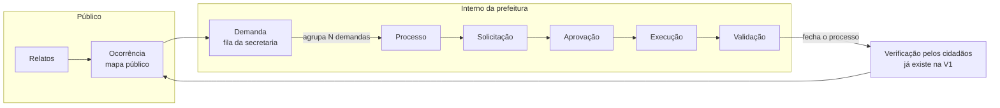
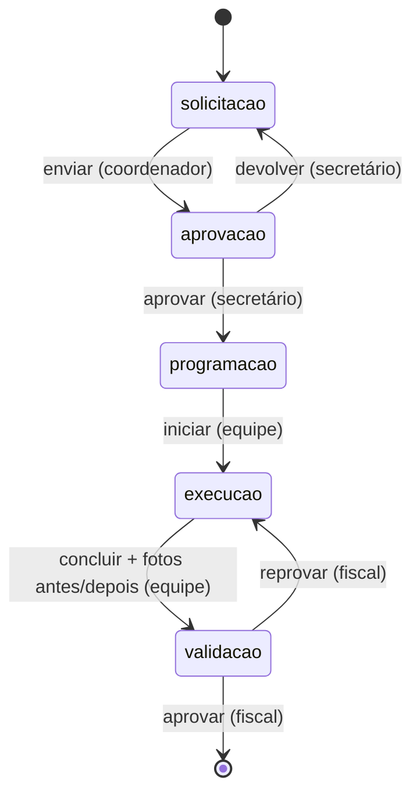

# Fiscaliz.ai Gestão: visão, escopo e primeiros passos

> Rascunho de 28/11/2026. Nada aqui está decidido: as decisões viram ADRs conforme forem tomadas. As perguntas em aberto estão na [seção 9](#9-perguntas-em-aberto).

## 1. A ideia em uma frase

Hoje o Fiscaliz.ai é o **funil**: o cidadão relata, a IA tria e a ocorrência chega ao órgão certo. A V2 é o que acontece **depois** dentro da prefeitura: cada secretaria transforma ocorrências em **demandas**, agrupa demandas em **processos** e conduz cada processo por um **fluxo** que ela mesma define, até a execução e a validação.



O fechamento do processo dispara a verificação que já existe (30% dos cidadãos confirmam). O ciclo público e o interno se encontram só nas duas pontas: a ocorrência entra, a resolução sai. O meio não é público.

## 2. Princípios

1. **Configuração, não código por prefeitura.** Apucarana e a próxima cidade rodam o mesmo software. O que muda são dados: organograma, fluxos, formulários, regras de prioridade, módulos ligados.
2. **Fluxo é dado versionado.** Um fluxo é uma definição declarativa (JSON validado por zod) interpretada por um motor pequeno. Processo em andamento fica preso à versão do fluxo com que começou; editar o fluxo não quebra o que já está rodando.
3. **Mesma filosofia da V1 ([ADR 0004](../adr/0004-por-que-nao-langgraph.md)):** a IA sugere (agrupar demandas, prioridade, resumo), mas quem decide a transição de etapa é o motor determinístico e uma pessoa com permissão.
4. **Tudo auditável.** Todo evento de processo vai para um log só de inclusão (quem, quando, o quê, de qual valor para qual). Administração pública precisa responder a controle interno, Tribunal de Contas e pedidos via LAI.
5. **Modular de verdade.** O núcleo é pequeno; módulos se ligam por prefeitura. Desligado = sem menu, sem rota, sem cobrança.
6. **Dado no Brasil.** Banco, arquivos e backups em território nacional. Serviços externos que tocam dado pessoal precisam de alternativa nacional ou de anonimização antes (como já fazemos com fotos).
7. **Não construir a UI de edição de fluxo primeiro.** Os 2 ou 3 primeiros fluxos são modelados por nós, em JSON, junto com a secretaria. O editor visual só vem quando soubermos qual abstração aguenta casos reais. Construir o editor antes é a forma mais rápida de acertar a abstração errada.

## 3. Conceitos (proposta para o GLOSSARY)

| Termo | O que é | Nome no código |
|---|---|---|
| Prefeitura | Cliente; isola todos os dados (tenant) | `municipality` |
| Unidade | Nó do organograma: secretaria, departamento, divisão, equipe. Substitui e generaliza o `agency` atual | `unit` |
| Servidor | Pessoa da prefeitura com login. Nunca é o cidadão | `staffMember` |
| Papel | Conjunto de permissões numa unidade (secretário, coordenador, fiscal, equipe de campo) | `role` |
| Demanda | Item interno de trabalho numa unidade. Nasce de uma ocorrência, mas também pode nascer de ofício, de ofício da Câmara, de protocolo | `demand` |
| Processo | Trabalho que resolve uma ou mais demandas e percorre um fluxo | `case` (evitar `process`, que colide com o global do Node) |
| Fluxo | Definição versionada das etapas, transições, papéis, formulários e prazos | `workflow` / `workflowVersion` |
| Etapa | Estado de um processo dentro do fluxo | `stage` |
| Transição | Ação que move o processo de uma etapa para outra, com condição e papel exigidos | `transition` |
| Tarefa | Trabalho atribuído a uma pessoa ou equipe dentro de uma etapa | `task` |
| Formulário | Campos exigidos numa etapa ou transição (texto, número, fotos, assinatura) | `formDefinition` |
| Regra de prioridade | Fórmula da unidade que pontua demandas | `priorityRule` |
| Módulo | Funcionalidade que a prefeitura liga ou desliga | `module` |

Regra de visibilidade: **ocorrência é pública; demanda, processo e tudo abaixo é interno.** O cidadão só vê o estado público da ocorrência ("em andamento", "resolvida").

## 4. O motor de fluxo

### 4.1 O que uma definição descreve

Exemplo do caso "tapa-buraco" da Secretaria de Obras (ilustrativo; o real sai da descoberta, seção 7):



Cada etapa e transição pode declarar:

- **quem pode agir:** papel + unidade (o secretário de Obras aprova, não o de Saúde);
- **formulário exigido:** campos, fotos, anexos; validado no servidor com o mesmo schema;
- **condições:** "custo estimado > R$ 50 mil exige aprovação extra";
- **prazo (SLA):** alerta e escalonamento quando vence;
- **efeitos:** notificar alguém, criar tarefa, ao fim disparar a verificação dos cidadãos.

Um processo também pode ter **tarefas em paralelo** (ex.: cada demanda agrupada vira uma tarefa de execução com sua própria foto; a etapa só termina quando todas terminam). Isso cobre o caso dos 50 buracos sem precisar de BPMN completo.

### 4.2 Construir ou usar pronto

| Opção | Prós | Contras |
|---|---|---|
| **Motor próprio: máquina de estados + JSON** (recomendado) | Pequeno, no nosso domínio, testável como o `stateMachine.ts` da V1; definição é dado que a UI edita depois | Paralelismo e temporizadores ficam por nossa conta (escopo limitado, ver acima) |
| BPMN (Camunda, Flowable) | Padrão de mercado, editor visual pronto | Pesado, Java, notação que secretário não usa; Camunda 8 é licença paga em produção |
| Temporal / execução durável | Robusto para fluxos longos | Fluxo vira código, não dado: a prefeitura não edita pela UI. Útil depois para integrações, não para o modelo do fluxo |

Recomendação: motor próprio, com o escopo da 4.1 e nada além até um caso real pedir.

### 4.3 Formulários dinâmicos

A definição guarda os campos em JSON. No front, geramos o schema zod a partir da definição e renderizamos com react-hook-form. No servidor, o mesmo schema valida antes da transição. Um único ponto de verdade para o formulário.

### 4.4 Priorização

Cada unidade define sua fórmula como **pesos sobre atributos**, sem linguagem de programação:

```
pontuação = 40 × tipo de via (BR/rodovia 1,0 · arterial 0,7 · local 0,3)
          + 25 × apelo normalizado
          + 20 × dias em aberto normalizado
          + 15 × risco (perto de escola, hospital, ponto de ônibus)
```

- A V1 já tem apelo, categoria, local e data. Tipo de via e pontos sensíveis vêm do OSM/CNEFE que já usamos.
- Pontuação é **sugestão ordenando a fila**; o secretário pode furar a fila, e isso fica no log com justificativa.
- **Agrupamento sugerido:** demandas da mesma categoria, próximas no mapa e da mesma unidade são propostas como um processo ("12 buracos no Jardim Ponta Grossa, 1,2 km"). A pessoa confirma.

## 5. Módulos

| Módulo | Fase | Observação |
|---|---|---|
| **Núcleo**: prefeitura, organograma, servidores, papéis, auditoria | 1 | Sempre ligado |
| **Funil cidadão** (o Fiscaliz.ai de hoje) | já existe | Fonte de demandas |
| **Demandas e processos** + motor de fluxo | 1 | O coração da V2 |
| Painel gerencial (filas, prazos, produtividade por unidade) | 1–2 | |
| Editor visual de fluxos e de prioridade | 2 | Só depois de 2–3 fluxos reais |
| Equipes e agenda de campo (app mobile offline para a equipe) | 2 | React Native; foto com GPS e hora |
| Documentos (anexos, modelos, assinatura) | 3 | Assinatura ICP-Brasil/gov.br |
| Materiais/almoxarifado (massa asfáltica, lâmpadas) | 3 | |
| Integrações (protocolo, ERP municipal, portal da transparência) | 3 | Depende do sistema que Apucarana já usa |

Técnica: tabela `municipalityModules` + verificação no servidor (rota e função) e no front (menu). Nada de build por cliente.

## 6. Infraestrutura e governança de dados

### 6.1 O conflito com a stack atual

A V1 roda em serviços fora do Brasil: Convex Cloud e Vercel (EUA), Anthropic, ElevenLabs e Modal. Para o funil público com dado anonimizado isso foi aceitável no hackathon. Para gestão interna da prefeitura, com dados de servidores e processos, não atende o princípio 6.

### 6.2 Opções

| Opção | Comentário |
|---|---|
| **Nuvem com região no Brasil** (AWS São Paulo, Magalu Cloud, outras nacionais) — recomendado para o piloto | Dado fica no país, operação gerenciada, backup e criptografia prontos. Magalu Cloud é empresa brasileira, sujeita só à lei brasileira, se isso pesar para a prefeitura |
| Servidor físico na cidade (micro data center) | Soberania máxima, mas energia, refrigeração, segurança física, backup fora do local e plantão viram problema nosso. Faz sentido depois, como opção para prefeituras que exigirem, se o software for portável |
| Híbrido | Nuvem no Brasil como principal e cópia de backup num equipamento na prefeitura. Bom argumento de governança com custo baixo |

**Requisito que viabiliza tudo isso:** o sistema empacotado em containers, com Postgres e armazenamento compatível com S3. Assim o mesmo artefato roda na nuvem nacional hoje e num servidor físico amanhã.

### 6.3 Banco: manter o Convex ou ir para Postgres

Para o núcleo de gestão, recomendo **Postgres** (com Drizzle, por exemplo): o domínio é relacional (organograma, permissões, processos, relatórios), a TI da prefeitura e o Tribunal de Contas vão pedir exportação e consulta em SQL, Row Level Security isola prefeituras, e roda em qualquer nuvem brasileira ou servidor local. O Convex tem versão self-hosted open source sobre Postgres, o que mantém o código atual, mas é uma aposta menor em operação e relatórios. Decisão para uma ADR (pergunta 3).

### 6.4 IA e terceiros

- **LLM:** verificar disponibilidade do Claude via AWS Bedrock na região de São Paulo (com ou sem inferência entre regiões) antes de prometer "dado não sai do país". Alternativa: anonimizar antes de chamar o modelo.
- **Transcrição e visão computacional:** avaliar rodar modelos abertos (Whisper, YOLO) na própria infraestrutura nacional.
- **LGPD:** relatório de impacto (RIPD), base legal "execução de políticas públicas", encarregado de dados definido com a prefeitura, retenção por tipo de dado.

## 7. Por onde começar

### Fase 0: descoberta com a Secretaria de Obras (2 a 3 semanas)

O passo mais importante, e não é código.

1. Entrevistar secretário, coordenador e uma equipe de campo: como uma demanda de buraco chega hoje, quem decide, onde fica registrada (papel, planilha, WhatsApp, sistema), como se programa a equipe, como se prova que foi feito.
2. Desenhar o fluxo real, com exceções ("e quando falta massa asfáltica?").
3. Levantar o organograma e os sistemas que a prefeitura já usa (protocolo, ERP).
4. Combinar **2 indicadores de sucesso** do piloto. Exemplo: tempo entre ocorrência e execução; % de processos com foto de validação.

### Fase 1: piloto com uma secretaria (8 a 10 semanas)

- Núcleo: prefeitura, organograma, servidores, papéis, auditoria.
- Ocorrência da V1 → demanda na fila de Obras.
- Agrupar demandas em processo (manual + sugestão por proximidade).
- Motor de fluxo com 1 fluxo real, definido em JSON por nós.
- Etapas com formulário e fotos; fechamento dispara a verificação dos cidadãos.
- Fila ordenada por regra de prioridade fixa (configurada por nós).
- Hospedagem no Brasil.

**Fora da Fase 1:** editor visual de fluxo, módulos de documentos e materiais, integrações, app mobile nativo (a equipe usa a web no celular).

### Fase 2: segunda secretaria e o editor

Modelar um fluxo de outra secretaria (Serviços Públicos ou Meio Ambiente, conforme o [COMPETENCIAS.md](../../COMPETENCIAS.md)). Se a abstração aguentar os dois sem gambiarra, construir o editor visual de fluxos e de prioridade.

### Fase 3: outras prefeituras e módulos

Cadastro de nova prefeitura sem código, módulos opcionais, integrações.

## 8. Encaixe no edital de Apucarana

O que consegui confirmar até agora (o site da prefeitura não abriu desta sessão; fontes na conversa):

- **Sandbox Regulatório:** ambiente de testes sem custo para o município, em que startups, empresas, professores e acadêmicos testam soluções com regras flexibilizadas sob controle municipal. Credenciamento contínuo por 24 meses, segundo uma das fontes. **É o encaixe natural:** pedir o credenciamento para pilotar a Fase 1 com a Secretaria de Obras.
- **Fomento à Inovação:** R$ 280 mil do Fundo Municipal de Inovação, em bolsas de R$ 600 a R$ 1 mil para pesquisa e desenvolvimento, gestão do Idepplan com comitê gestor. Áreas prioritárias incluem **cidades inteligentes**. As fontes divergem sobre quem pode concorrer (startups ou só instituições sem fins lucrativos, ICTs e instituições de ensino sediadas em Apucarana). Se for o segundo caso, o caminho é parceria com uma universidade local, com bolsistas no projeto.
- **Depois do sandbox:** o Marco Legal das Startups (LC 182/2021) prevê o **CPSI** (Contrato Público para Solução Inovadora), que permite à prefeitura contratar a solução testada sem licitação tradicional. É a ponte entre piloto e contrato.

A ler no edital completo: elegibilidade (CNPJ, sede em Apucarana), o que o sandbox flexibiliza, regras de acesso a dados do município, propriedade intelectual e prazos.

## 9. Perguntas em aberto

1. **Elegibilidade:** temos CNPJ? Precisa ser sediado em Apucarana? Há universidade parceira para o fomento?
2. **Acesso:** já existe contato na Secretaria de Obras ou no Idepplan para a Fase 0?
3. **Banco:** Postgres para o núcleo de gestão (recomendado) ou Convex self-hosted?
4. **Nuvem:** AWS São Paulo ou provedor nacional (Magalu Cloud)? A prefeitura tem preferência ou exigência?
5. **Login dos servidores:** e-mail e senha com 2FA no piloto, gov.br depois?
6. **Funil e gestão:** um produto só ou dois apps (funil público + gestão interna) sobre o mesmo núcleo? Recomendo dois apps e um núcleo, porque separa o que é público do que é interno também na infraestrutura.
